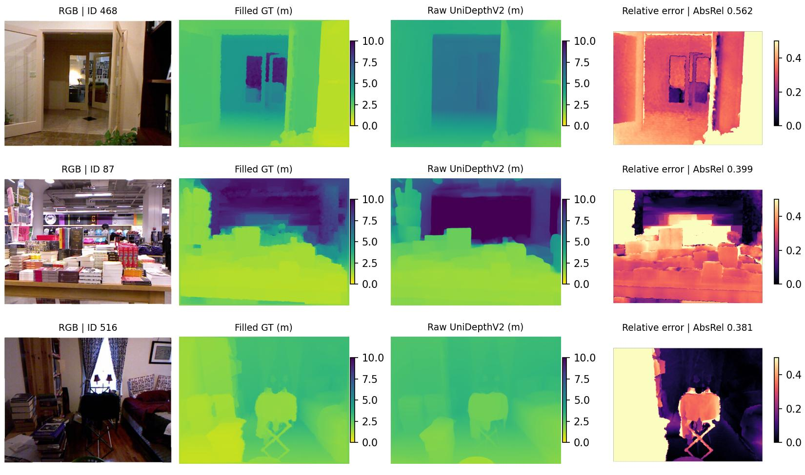
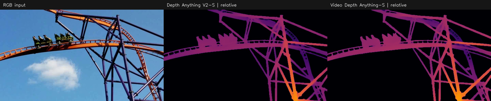

# AIAA 3201 Final Project — Monocular Metric Depth & Video Consistency

本仓库用于两人的 Project 3 协作，依据 2026-11-02 更新的作业要求。
**Part 2 复现结果和协作入口已合入 `main`。**

| 部分 | 负责人 | 当前进度与入口 |
|---|---|---|
| Part 1 | **Yongru CHEN** | 接入 Middlebury 双目结果和逐帧 DA V2。见[交接说明](docs/team-handoff.md) |
| Part 2 | **Wenhan XU** | NYU 654 张测试图的米制评估和 VDA 视频复现已完成。见[复现说明](docs/part2.md) |
| Part 3 | 小组讨论 | [作业 PDF 的 A–F 拓展方向](docs/part3-directions.md) |

Yongru 可以把交接说明直接交给 Codex，从最新版 `main` 开 Part 1 分支。
把双目图表和指标整理到 `results/stereo/`，逐帧 DA V2 深度按交接格式准备，
再开 PR 合入小组结果。

## Part 2：你要运行的内容

1. **UniDepthV2 ViT-S**：RGB-only 推理，在官方 NYU 654 张测试图上评估原始米制深度。
2. **Video Depth Anything Small**：离线 FP16 视频推理，与 Depth Anything V2 Small 的逐帧结果比较。
3. 记录数值指标、实际输入尺寸、时间、显存和困难案例；比较视频仅做定性分析。

具体解释见 [Part 2 操作与结果说明](docs/part2.md)。

## 安装与下载

使用 **Python 3.11 或更新版本**；实测为 Python 3.13.11、PyTorch 2.7.1+cu118、
torchvision 0.22.1、Windows 11、NVIDIA RTX 4050 Laptop 6GB。
Python 3.11+ 是下载器所用 `hashlib.file_digest` 的要求。

```bash
git clone https://github.com/Farewellxxxx/AIAA-3201-Final-Project.git
cd AIAA-3201-Final-Project
python -m venv .venv
# Windows PowerShell: .venv\Scripts\Activate.ps1
# Linux/macOS: source .venv/bin/activate
python -m pip install torch==2.7.1 torchvision==0.22.1 --index-url https://download.pytorch.org/whl/cu118
python -m pip install -r requirements.txt
python scripts/download.py --group all
```

下载器获取官方代码、Small 权重、NYU labeled MAT（约 2.8GB）、官方划分和
Middlebury trainQ 输入。代码 commit、模型 revision、下载校验值固定在
[`resources.lock.json`](resources.lock.json)。不需要 NYU raw video collection。
为下载、依赖和本地预测预留约 8GB 空间。

下载的数据、模型、第三方源码和 `.npy/.npz` 缓存不会进入 Git。
不需要可选的 xFormers、Triton 或 UniDepth KNN 训练扩展；该推理配置使用官方 fallback。

## 复现命令

从仓库根目录运行。Part 2 只需测试集预测，不需要运行训练集或尺度校准。

```bash
python -m unittest discover -s tests -v
python scripts/nyu.py --demo
python scripts/nyu.py --split test
python scripts/evaluate_baseline.py
python scripts/figures_part2.py
python scripts/video.py --input-size 294 --allow-short-clip
```

`nyu.py` 校验设置与权重后复用已有预测；`evaluate_baseline.py` 固定 scale=1，
要求完整覆盖 654 张测试图，输出到 `results/nyu/baseline/`。
`video.py` 同时产生逐帧基线、视频模型对比和一个已有的背景虚化演示；
应用演示不改变深度模型，也不作为 Part 3 改进结论。

Yongru 的 Part 1 几何练习可独立运行：

```bash
python scripts/stereo.py
```

两种视频模型的实际输入均为 **294×518**，输出为 **360×640**。
若更改设置，请使用独立结果目录或先备份旧输出，不能混用不同设置的缓存。
默认 video 参数为 518；本机显存配置的复现命令明确使用 294。

## 用已有深度合成视频

两份深度 NPZ 及对应 JSON 齐备时，从仓库根目录运行下面的命令。
合成在 CPU 上完成，输出到 `tmp/`。输入格式和旧缓存用法见[交接说明](docs/team-handoff.md#视频文件约定)。

```bash
python scripts/compose_video.py --source third_party/Video-Depth-Anything/assets/example_videos/davis_rollercoaster.mp4 --dav2 results/video/dav2_depths.npz --vda results/video/vda_depths.npz --output tmp/rgb_depth_comparison.mp4
```

## 已记录的原始复现结果

| 模型与测试集 | AbsRel ↓ | RMSE (m) ↓ | δ₁ ↑ |
|---|---:|---:|---:|
| UniDepthV2 ViT-S，NYU 全部 654 张测试图，scale=1 | 0.11454 | 0.39883 | 0.89232 |

| 模型 | 实际网络输入 | 时间/图像或源帧 | 峰值 allocated GPU memory |
|---|---|---:|---:|
| UniDepthV2 ViT-S | 490×644 | 45.82 ms | 508.5 MB |
| Depth Anything V2 Small | 294×518 | 36.62 ms | 235.5 MB |
| Video Depth Anything Small | 294×518（窗口 32 帧） | 47.54 ms | 1319.3 MB |

NYU 时间为 **654 张测试图的均值**，不混入训练图。视频时间为官方离线推理总时间
除以 70 个真实源帧；排除模型加载、warm-up 和可视化，CUDA 同步后计时。
峰值是 PyTorch allocated memory，不含全部驱动/显示占用。结果不是论文原始分数的复刻声明。

### 原始米制深度困难案例



### 相同视频帧的比较



- [RGB / 两种模型深度对比视频](results/video/rgb_depth_comparison.mp4)
- [已有的背景虚化演示视频](results/video/depth_aware_blur_demo.mp4)

## 官方视频长度差异

作业写 first 100 frames，但指定仓库中的 `davis_rollercoaster.mp4` 实际只有
**70 帧、24 FPS**。这里处理全部 70 个真实帧，没有重复、插值或补帧。
两种模型用完全相同的帧、同一个调色板和各自固定的整段归一化范围。
颜色表示 **relative depth**，不是可横向比较的米制距离。

没有 `--allow-short-clip` 时，程序会拒绝不足 100 帧的源文件。
提交时需要说明这一源文件差异，或在老师提供更新视频后重新运行。
源视频 SHA256：`7268cbecd9806a1e90a416de50dc02e50b4ae01428d5971837cf679dd0c87cb8`。

## 评估协议与目录

- NYU：`images[i].transpose(2,1,0)`；filled `depths[i].T`，单位为米。
- MATLAB split ID 减 1；795 张训练图、654 张测试图互不重叠。
- 输出 480×640；crop `[45:471,41:601]`；有效 GT 严格位于 `(0.001,10)` 米。
- 预测裁剪到 `[0.001,10]`；先逐图计算 AbsRel、RMSE、δ₁，再对 654 张图等权平均。
- 无任何 test GT scale alignment；非有限预测直接报错。
- Stereo：OpenCV disparity /16；`z_m=focal_px*baseline_mm/(disparity+doffs)/1000`。

```text
depth_project/           几何、掩膜、指标与数据读取
scripts/nyu.py           官方 UniDepthV2 RGB-only 推理
scripts/evaluate_baseline.py  Part 2 原始尺度评估
scripts/video.py         DA V2 / VDA 同帧比较
scripts/compose_video.py 合成已有两套视频深度
scripts/stereo.py        Part 1 共享参考实现
tests/                  协议与复现检查
results/nyu/baseline/    原始测试指标、逐图 CSV 与困难案例
results/video/           对比视频、截图、配置与计时记录
docs/part2.md            当前阶段的操作和分析说明
docs/team-handoff.md     Part 1 目录、视频交接格式和合成命令
docs/part3-directions.md  作业的六个拓展方向
```

完整原始深度由脚本生成到 `results/nyu/predictions/` 和 `results/video/*.npz`，
本机已保存的原始预测仍保留在原实验目录中。仓库仅提交轻量结果及演示视频。
最终报告和 `depth_results.zip` 在两部分结果核对后统一整理。

## 来源与引用

- [UniDepth / UniDepthV2](https://github.com/lpiccinelli-eth/UniDepth)
- [Depth Anything V2](https://github.com/DepthAnything/Depth-Anything-V2)
- [Video Depth Anything](https://github.com/DepthAnything/Video-Depth-Anything)
- [NYU Depth V2](https://cs.nyu.edu/~fergus/datasets/nyu_depth_v2.html)
- [Middlebury Stereo v3](https://vision.middlebury.edu/stereo/submit3/)

学术条目见 [references.bib](docs/references.bib)，第三方来源说明见
[THIRD_PARTY_NOTICES.md](THIRD_PARTY_NOTICES.md)。官方源码、数据和预训练权重遵循各自许可。
