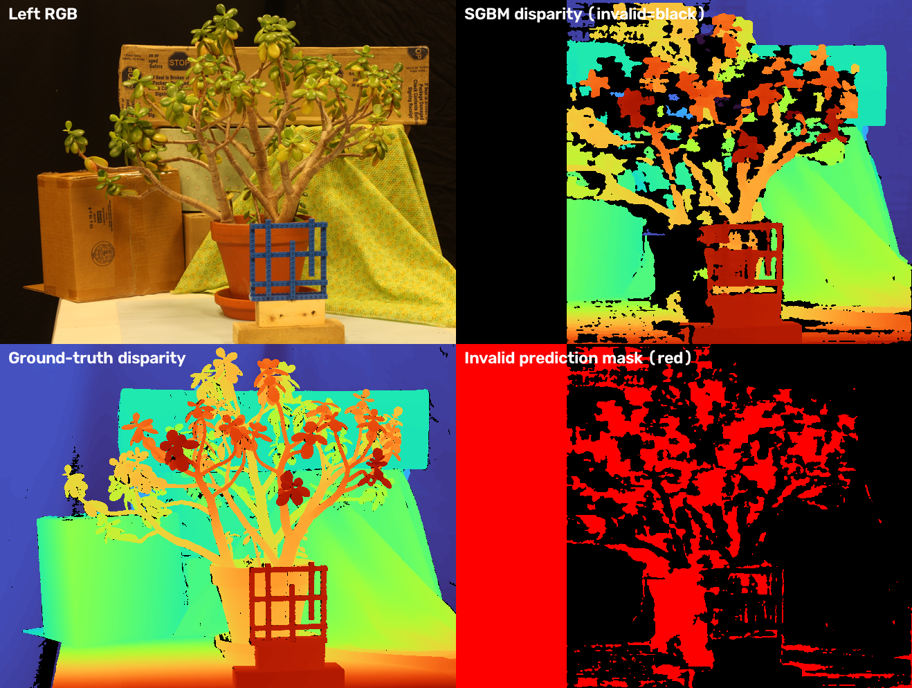
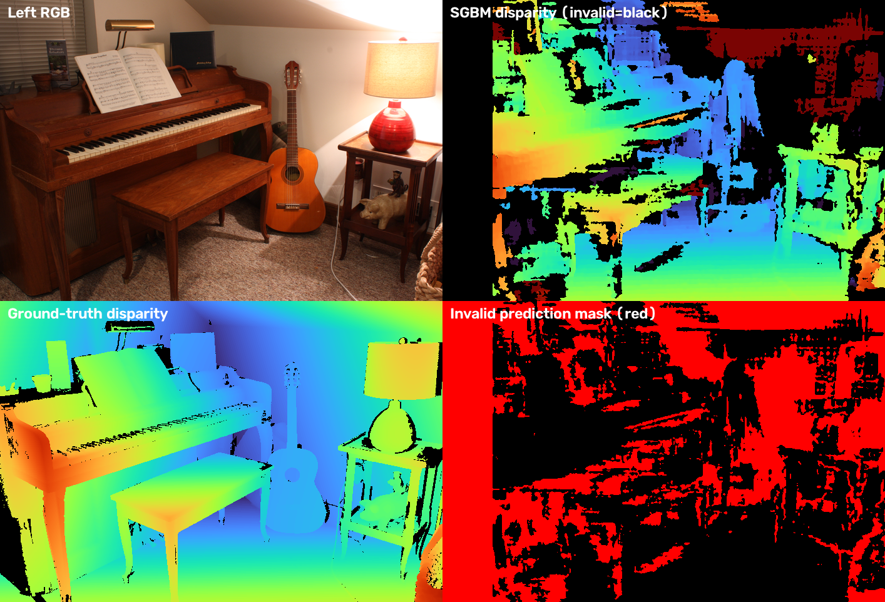
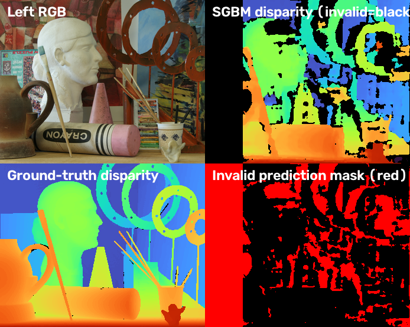
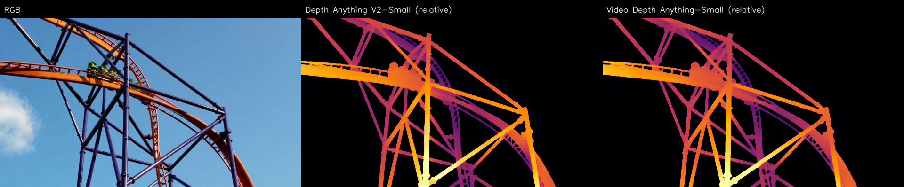

# Part 1 — Stereo Geometry and Frame-Wise Depth

## Scope and data

Part 1 covers the 15 Middlebury Stereo v3 `trainQ` scenes and the supplied `davis_rollercoaster.mp4` clip. For the video baseline, Depth Anything V2-Small is run independently on each frame; its output is **relative depth**, not metric depth. The temporal Video Depth Anything comparison is qualitative and has no ground-truth video depth.

The official rollercoaster file is 960×540 at 24 FPS and contains only 70 frames. The assignment asks for the first 100 frames, but the designated repository asset itself has 70; all 70 genuine frames were used, with no padding or duplication. Its SHA256 is `7268cbecd9806a1e90a416de50dc02e50b4ae01428d5971837cf679dd0c87cb8`.

## Middlebury StereoSGBM

Images and calibration are quarter resolution. OpenCV StereoSGBM is applied to grayscale rectified pairs. Per scene, `numDisparities = ceil(ndisp/16)×16`, `blockSize=5`, `P1=8×5²`, `P2=32×5²`, `disp12MaxDiff=1`, `uniquenessRatio=10`, `speckleWindowSize=100`, `speckleRange=2`, and `STEREO_SGBM_MODE_SGBM_3WAY`. OpenCV's fixed-point output is divided by 16 to obtain pixel disparity.

For each scene, depth in meters is calculated from its quarter-resolution calibration:

`Z = focal_length_px × baseline_mm / (disparity_px + doffs_px) / 1000`.

A prediction is invalid if it is non-finite or disparity is `<= 0 px`. MAE is computed over pixels with finite positive ground-truth disparity and valid predicted disparity. Coverage is the fraction of finite positive GT pixels that have a valid prediction; no invalid values are included in MAE.

### Results

| Summary over 15 scenes (equal scene weighting) | Result |
|---|---:|
| Mean disparity MAE on valid overlap | **1.986 px** |
| Mean valid prediction coverage | **75.285%** |

Per-scene values are in [`results/stereo/per_scene.csv`](../results/stereo/per_scene.csv); method settings and aggregate values are in [`results/stereo/metrics.json`](../results/stereo/metrics.json). The table is a classical stereo exercise and is separate from NYU metric-depth evaluation.

### Representative difficult cases

- **PianoL:** MAE 6.622 px, coverage 58.1%. Large invalid areas and errors occur around weakly textured/occluded regions and thin structures.
- **Jadeplant:** MAE 5.557 px, coverage 57.8%. Fine leaves and repeated plant texture produce fragmented disparity; low-texture background regions are often invalid.
- **ArtL:** MAE 2.102 px, coverage 62.4%. Coverage loss at boundaries and occlusions remains visible even though overlap MAE is lower than the two cases above.

These cases show that a strong score on valid overlap does not imply dense coverage: invalid regions are excluded from MAE and must be interpreted alongside coverage.







## Video frame-wise baseline and temporal comparison

Depth Anything V2-Small is applied independently to the same 70 RGB frames used by Video Depth Anything-Small. In the recorded run, frames were resized with `max_res=640` to 640×360, `input_size=518`; Video Depth Anything used its default FP16 inference. Both outputs use the inferno palette and a fixed robust display range per method computed over the entire clip (1st–99th percentiles), never per-frame normalization. These separately normalized colors are not a shared metric scale.

On the RTX 5060 Ti with PyTorch 2.7.0+cu128, measured inference was 0.074 s/frame for frame-wise DA V2-Small (peak allocated GPU memory 546 MB) and 0.095 s/frame for VDA-Small FP16 (peak 8.1 GB). These numbers correspond to the 518 input setting and this hardware; the project-wide Part 2 run may use a smaller input setting on a lower-memory GPU.

The side-by-side outputs are visual only. The clip contains thin rails, moving riders, occlusions, and changing viewpoints; inspect edge stability and flicker over time. There is no temporal ground truth, so visual smoothness does not establish metric accuracy. The course repository's `scripts/video.py` provides the shared reproducible comparison and validates frame count/source metadata. A representative frame is shown below.



## Reproduction

After `python scripts/download.py --group small`, run:

```bash
python scripts/stereo_part1.py
```

The entry point reads the downloaded quarter-resolution trainQ files under `data/middlebury/`, writes report-facing metrics and visualizations to `results/stereo/`, and leaves full `.npy` predictions local (the repository ignores generated arrays). To reproduce the video baseline and produce an NPZ plus source/frame metadata, follow `docs/team-handoff.md` and run `python scripts/video.py --input-size 518 --allow-short-clip` when the hardware has enough memory. The shared script writes local arrays under `results/video/`; they are intentionally excluded from Git.
